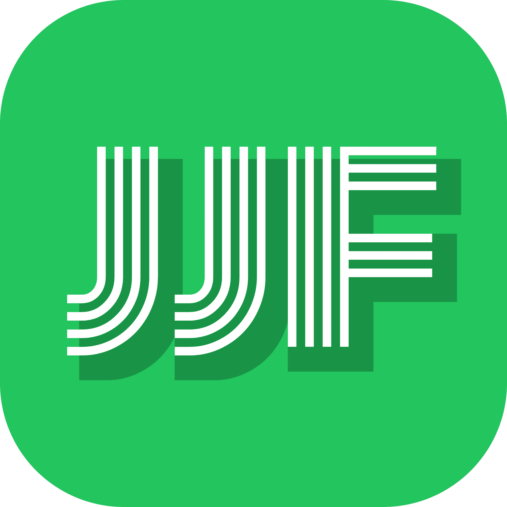

<p></p>

# JJF External Deck Skill

[中文 README](README.md)

A brand-specific Agent Skill for JJF AI Craft Labs external presentations: company introductions, OPC ecosystem proposals, enterprise FDE, AI training, developer communities and international events.

**One brand system, not one repeated template.** This repository provides instructions, assets, prompts, version-management helpers and quality gates. It is not a standalone image generator, a slide-conversion engine or a finished editable deck.

## Install

After the repository is published, with Git and Node.js/npm available:

```bash
npx skills@latest add fuhaooo/jjf-external-deck-skill --skill jjf-external-deck --agent codex --global
```

Remove `--global` for a project-level installation. For Claude Code, use `--agent claude-code`. Agent-specific image tools, page workers and external integrations must be checked separately; installation is not an end-to-end compatibility guarantee.

Alternatively, clone or extract the complete repository and run:

```bash
python3 skills/jjf-external-deck/scripts/install_local.py --scope user
```

The local installer requires Python 3.10+, copies the complete skill into `~/.agents/skills/jjf-external-deck`, refuses to overwrite an existing installation, and does not download dependencies or edit user settings. Use the environment in which the agent runs: WSL and native Windows use different home directories. Do not copy only `SKILL.md`.

## Use in Codex

```text
Use $jjf-external-deck to create a JJF external presentation from my supplied evidence.
Lock the audience, narrative, page order and exact copy first.
Use the official logo and dark/green brand system; vary composition and visual density.
Produce three representative slides before expanding the deck.
Return one clearly identified version per page.
After image approval, actually run $image-to-editable-ppt and validate the editable PPTX.
Import into a new Canva design only when requested and authorized.
```

## Editable PowerPoint dependency

Install the independent upstream skill when rebuilding slide images:

```bash
npx skills@latest add ningzimu/image-to-editable-ppt-skill --skill image-to-editable-ppt --agent codex --global
```

Read its installed `SKILL.md` and CLI reference, install its `editppt` runtime, and check prerequisites. This repository does not vendor or silently install upstream code. Upstream conversion follows `prepare → dispatch → record → finalize`. Multi-page reconstruction requires real page workers under the upstream contract.

Text should be native text boxes, simple diagrams native shapes, and complex imagery separate replaceable image assets. A full-slide image with text overlaid is not acceptable editable reconstruction. A native-first slide can be assembled directly instead of rasterizing and running OCR again.

Canva requires separate access and post-import validation. Conversion and API costs, availability and fidelity are not guaranteed.

Repeated page, chapter, website and service labels share a project [typography contract](skills/jjf-external-deck/templates/typography-contract.json). Normalize these native text roles after reconstruction and assembly instead of reproducing AI-generated font drift; preserve intentional cover hierarchy and explicit references. The [measured-inventory audit](skills/jjf-external-deck/references/typography-consistency.md) reports missing font properties as unknown. Canva interfaces without font-family or letter-spacing controls cannot establish full font consistency, and native labels must not silently become outlined graphics.

## Python helpers and tests

Only install Python dependencies when using the relevant helpers:

```bash
python3 -m venv .venv
source .venv/bin/activate
python -m pip install -r requirements-dev.txt
python -m unittest discover -s skills/jjf-external-deck/tests -v
python -m unittest discover -s tests -v
python scripts/check_release.py
```

There are 43 core tests and 11 offline publication-safety tests. These do not prove agent compliance, live image conversion, visual quality or Canva fidelity. See [verification scope](docs/VERIFICATION.md).

## Brand, data and rights

Prefer the official `skills/jjf-external-deck/assets/logo/jjf-logo-primary.svg`, with the original PNG as a compatibility fallback. Transparent-white and white-on-black official variants are also included; see the [asset guide](skills/jjf-external-deck/assets/logo/README.md). Do not redraw them. Generated reference images are design studies, not evidence of real JJF events, clients, buildings or results.

For authorized edits to an existing Canva design, follow the [in-place editing route](skills/jjf-external-deck/references/canva-in-place-editing.md). Preserve non-target content, reuse explicit authorization, verify saved state, and disclose outlined wordmarks as graphics rather than character-editable text. Re-locking content now invalidates only changed pages; legacy projects without per-page hashes migrate conservatively.

Private tender documents, prices, personal contact data, shared conversation links, font files and credentials are excluded. No general-purpose open-source license has been selected on the owner's behalf. Preserve the original [NOTICE](NOTICE.md); installation does not confer trademark or endorsement rights.

The full production specification, storyboard, examples and troubleshooting are in the [Chinese README](README.md) and the [skill directory](skills/jjf-external-deck/).

Maintainers: see [publication guide](docs/PUBLISHING.md). The publisher is dry-run by default, requires explicit visibility and `--execute`, refuses existing targets, and verifies the remote commit and README before reporting success.
