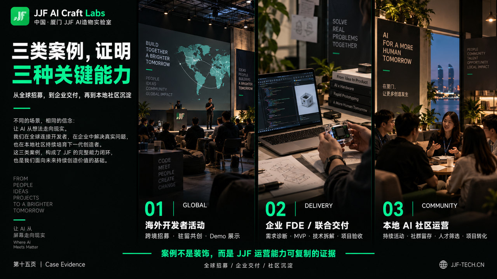

<p align="left">
  
</p>

# JJF External Deck Skill

**面向 JJF AI Craft Labs 的对外宣传 Deck 工作流：从真实资料、叙事和品牌视觉，到单页预览、可编辑 PowerPoint 与 Canva 交付。**

[English](README.en.md) · [安装](#安装) · [使用示例](#使用示例) · [图片转可编辑-ppt](#图片转可编辑-ppt) · [维护与发布](docs/PUBLISHING.md)

> 统一品牌，不重复模板。每页有明确主题和视觉重点；好看的 PNG 不等于可编辑的 PPT。
>
> **这是 Agent Skill，不是独立生图软件、在线 PPT 网站或图片转换引擎。**安装后，需要在具备相应图片、文件、终端及可选 Canva 工具的 Agent 环境中运行。

## 适用场景

JJF 综合品牌介绍、面向政府／园区／集团的 OPC 生态合作方案、企业 FDE 与 AI 定制开发介绍、AI 培训、开发者社区、海外技术活动和 Hacker House。

仓库内置一套 **19 页 OPC 叙事工作基线**，不是所有项目都必须使用的固定页数。其他场景使用对应叙事预设。

## 能力与边界

| 模块 | 提供什么 |
|---|---|
| 叙事与证据 | 受众定位、内容锁、来源台账；区分事实、自述、计划、示例和冲突口径 |
| JJF 品牌 | 正式 Logo、黑绿配色、文字层级、留白、页眉页脚与视觉节奏 |
| 逐页设计 | 生成／修改提示词；同一品牌下变化构图、主视觉、图文比例与密度 |
| 版本管理 | 页面 revision、文件哈希、审批依据；只交付一个明确的当前版本 |
| 可编辑交付 | 将已批准的整页图片交给独立的 `image-to-editable-ppt` Skill，并验收结构与视觉 |
| Canva | 以合格 PPTX 导入新设计，检查字体、换行、图层与实际可编辑性 |

**不承诺：**安装后自动获得图片模型、无限额度、免费 OCR、Canva 权限、百分之百还原，或把照片和三维物件全部变成原生矢量。不会把整页背景图覆盖一层文本冒充拆解完成。

## 设计参考



*编辑式三联画是正向审美参考之一，不是全套固定模板。上图是历史 AI 生成示意，不证明真实活动、客户或空间；其中旧 Logo 和文字不能作为最终资产或事实母版。正式图标首选 `assets/logo/jjf-logo-primary.svg`，不支持SVG时用原PNG。更多正例、候选与反例见 [参考图索引](skills/jjf-external-deck/assets/references/index.json)。*

## v1.0.3：拆解后的标签一致性

拆解后按语义角色统一页码、章节、网址、底部说明的中英文字体、字号、字重、间距和锚点，不照抄 AI 生图的字体缺陷。所有页面 worker 共用一份[文字样式合同](skills/jjf-external-deck/templates/typography-contract.json)，组装及 Canva 保存后分别验收；封面层级和用户指定参考优先。

新增[文字一致性审计](skills/jjf-external-deck/references/typography-consistency.md)：检查真实提取的属性，缺字体信息返回 unknown。Canva 接口未开放字体家族或字距时，不能宣称已经统一，也不能静默把原生文字换成图片。

## v1.0.2 补强

- 收录三种官方SVG：绿色主标、透明白标、黑底白标，并保留原PNG兼容版；[查看用途与来源](skills/jjf-external-deck/assets/logo/README.md)。
- 增加“修改现有Canva”路线：按参考页统一品牌区、沿用已有直接修改授权、自动纠正确定错字，保存后核对其他对象未变。
- 内容锁改为按页追踪：修改一页只使该页审批失效，保留未变页；旧项目首次迁移保守处理。
- 补充临时事务失效、部分操作失败、字体/裁切和原始高清素材处理边界。

### 统一已有 Deck 的品牌区

```text
使用 $jjf-external-deck，在我指定的现有Canva PPT中操作。
从第3页起，将Logo、英文品牌名和中文说明统一为第2页的样式。
保留其他内容；确定的错字直接纠正并保存，不逐项询问。
核对目标页品牌组件，保存后确认第1、2页及非品牌对象未变。
```

## 安装

### 方式一：使用 Skills CLI（推荐）

需要 Git 和可使用 `npx` 的 Node.js/npm 环境。首次使用可能提示下载 Skills CLI，先审阅再确认。

```bash
# 可选：先查看仓库中可安装的 Skill
npx skills@latest add fuhaooo/jjf-external-deck-skill --list

# Codex：安装到用户级目录
npx skills@latest add fuhaooo/jjf-external-deck-skill --skill jjf-external-deck --agent codex --global
```

仅用于当前项目时，进入项目目录并去掉 `--global`：

```bash
npx skills@latest add fuhaooo/jjf-external-deck-skill --skill jjf-external-deck --agent codex
```

Claude Code 可以使用相同 Skill 内容，换成对应安装目标：

```bash
npx skills@latest add fuhaooo/jjf-external-deck-skill --skill jjf-external-deck --agent claude-code --global
```

安装器能够放置文件，不代表每个 Agent 都已完成端到端兼容性验证。图片工具、子 Agent、可编辑转换和 Canva 仍需在实际运行环境中探测。安装完成后重开会话；Codex 可用 `/skills` 查看，或在提示词中引用 `$jjf-external-deck`。

> 上述远程命令以仓库已发布且有访问权限为前提。拿到离线 ZIP、仓库尚未发布或网络受限时，使用下面的本地安装方式。私有仓库需要相应 GitHub 读取权限。

### 方式二：本地安装（不下载远程依赖）

克隆后，或将完整仓库 ZIP 解压并进入仓库根目录：

```bash
# 已发布后可克隆；已有解压目录则跳过这两行
git clone https://github.com/fuhaooo/jjf-external-deck-skill.git
cd jjf-external-deck-skill

# Python 3.10+；仅复制本地文件到 ~/.agents/skills/jjf-external-deck
python3 skills/jjf-external-deck/scripts/install_local.py --scope user
```

只安装到某个 Codex 项目：

```bash
python3 skills/jjf-external-deck/scripts/install_local.py --scope project --project /path/to/project
```

原生 Windows PowerShell 使用 `python` 代替 `python3`。WSL 中的 Codex 应在 WSL 中安装；Windows 原生 Codex 则在对应 Windows 用户环境安装。

**必须保留整个 `jjf-external-deck` 目录**，包括 `assets/`、`references/`、`prompts/` 和 `scripts/`。不要只复制 `SKILL.md`。本地安装器默认拒绝覆盖已安装版本，不更改 `config.toml`，不下载转换器或安装字体。

## 环境与依赖

| 使用阶段 | 需要的能力／依赖 |
|---|---|
| 读取 Skill、叙事与视觉规划 | 支持 Agent Skills 的助手 |
| 生成或修改图片 | 当前环境真实可调用的图片生成／编辑工具与相应权限 |
| 本地安装与项目管理脚本 | Python 3.10+；图片登记需 Pillow |
| 已有图片转可编辑 PPTX | 单独安装 `image-to-editable-ppt` 和它的 `editppt` CLI；按上游规则检查图片后端、OCR 和 page workers |
| 原生排版直出 PPTX | Agent 的演示文稿构建工具；不由本仓库自动安装 |
| Canva | 有权限的 Canva 连接或手动导入；导入后需二次验收 |
| 开发测试 | Pillow、python-pptx；见 `requirements-dev.txt` |

需要运行管理脚本时，建议在隔离环境安装：

```bash
python3 -m venv .venv
source .venv/bin/activate
python -m pip install -r requirements.txt
```

PowerShell 激活方式为 `.venv\Scripts\Activate.ps1`。仅阅读 Skill 不必安装 Python 包。

## 使用示例

### 1. 新建一套 JJF 对外 Deck

在 Codex 会话中输入，不是在 shell 中执行：

```text
使用 $jjf-external-deck，为 JJF 制作面向政府、园区和集团的 OPC 合作介绍。
以我提供的真实材料为依据，不虚构人数、案例或主办角色。
先锁定叙事、页序、精确文案与证据状态，再设计封面、方法页和案例页三个代表页。
使用正式 Logo 和黑绿品牌体系，逐页变化构图、主视觉和信息密度。
确认方向后扩展全套，每页只交付一个明确版本。
图片定稿后，实际调用 $image-to-editable-ppt，交付可编辑 PPTX 和验收报告。
```

### 2. 只改一页视觉，不改主题

```text
使用 $jjf-external-deck，重新设计第六页。
主题仍是“社区增长引擎 × 联合交付引擎”，只调整视觉。
保留两侧的服务内容、Hacker House 和“成功 OPC 反哺社区”的机制。
延续黑绿品牌体系，但不要重复上一页的办公室、人物、卡片或玻璃立方体。
```

### 3. 将批准图片转换为可编辑 PPT 并导入 Canva

```text
使用 $jjf-external-deck 和 $image-to-editable-ppt。
仅转换 manifest 中已批准的页面，不扫描整个图片文件夹。
先试转换一张代表页，再执行多页重建。
保留原始页号、文案、官方 Logo、图片来源和视觉风格。
验收原生文字、独立资产、渲染效果与实际编辑操作。
然后导入新的 Canva 设计，不覆盖旧官方介绍。
```

## 制作流程

```text
资料与需求 → 受众/叙事/证据 → 内容锁与页序
          → 整套视觉节奏 → 代表页 → 逐页生成与改稿
          → 图片验收与唯一版本 → 可编辑重建/原生组装
          → 结构+视觉+实际编辑检查 → PPTX → 可选 Canva 二次验收
```

“重做第 6 页”始终指内容锁里的第 6 页，不应被上传的空间方案带偏。公开政策、经营成果与规划承诺不能混写；没有来源的数据进入待确认清单。

## 图片转可编辑 PPT

本项目不复制转换器代码。后处理依赖作者独立维护的：

**[ningzimu/image-to-editable-ppt-skill](https://github.com/ningzimu/image-to-editable-ppt-skill)**

需要转换功能时另行安装并审阅其说明：

```bash
npx skills@latest add ningzimu/image-to-editable-ppt-skill --skill image-to-editable-ppt --agent codex --global
```

定位实际安装的 Skill 目录，按其中 `SKILL.md` 与 `references/cli-helper.md` 安装 CLI。路径不能凭空猜测；例如其文档中的安装形态是：

```bash
# <converter-skill-root> 必须替换为实际查到的安装路径
pipx install --editable <converter-skill-root>/cli
editppt doctor
```

实际重建遵循上游的 `prepare → dispatch → record → finalize` 状态机。**`prepare` 只准备任务；写一份交接提示词也不代表转换已执行。**多页任务按上游要求使用真实 page workers；缺少该能力应明确报告阻塞，不伪造完成状态。

文字目标是原生文本框；简单几何目标是原生形状；复杂照片／三维装置可作为独立可替换图片。已有原生文字和形状的页面可以直接组装 PPTX，不必先栅格化再 OCR。

完整边界见 [可编辑转换规范](skills/jjf-external-deck/references/editable-ppt-integration.md)。模型、OCR、图片调用与 Canva 费用由实际服务决定，本仓库不提供免费额度保证，也不接收密钥。

## 项目管理命令

以下命令从仓库根目录执行，实际项目建议放在仓库之外：

```bash
python3 skills/jjf-external-deck/scripts/deckctl.py init --project ../my-jjf-deck
python3 skills/jjf-external-deck/scripts/deckctl.py validate --project ../my-jjf-deck
python3 skills/jjf-external-deck/scripts/deckctl.py --help
```

填写 `content-lock.json` 的精确文案并获得真实审批后，使用 `lock-content`、`register-preview`、`approve-preview` 和 `handoff` 记录过程。详见 [Skill 使用说明](skills/jjf-external-deck/README.md)。不要复制假的审批话术骗过工具；`handoff` 只输出交接包，并明确标记 `conversion_executed=false`。

`init`目前以OPC19作为引导模板；其他受众应先按叙事预设替换内容锁页纲，再执行`lock-content`，不应直接套19页。

## 仓库结构

```text
jjf-external-deck-skill/
├── README.md / README.en.md
├── NOTICE.md                      # 品牌、参考图与授权边界
├── docs/                          # 发布说明、隐私与验证说明
├── scripts/                       # 仓库检查与 GitHub 发布辅助
├── tests/                         # 离线发布保护测试
├── requirements*.txt
└── skills/
    └── jjf-external-deck/
        ├── SKILL.md               # Agent 入口
        ├── agents/openai.yaml
        ├── assets/                # 正式 Logo、tokens、带状态标签的参考图
        ├── references/            # 叙事、视觉、制作流程、转换和 QA
        ├── prompts/               # 单页生成、改稿与交接模板
        ├── templates/             # OPC19、预算、证据与版本模板
        ├── scripts/               # deckctl、PPTX 初筛、本地安装
        └── tests/                 # 核心测试与待执行行为场景
```

## 更新与卸载

由 Skills CLI 安装时，使用该工具的 `check`／`update`／`remove` 命令，先查看当前版本的 `--help`；更新前备份本地改动。由本地安装器安装时，先备份旧 Skill 目录，再从已审阅的新版本复制。卸载只移除确认属于本 Skill 的安装目录，不删除客户项目、素材或生成稿。

不要将不同安装方式混用后再强制覆盖；依赖转换器也应单独记录实际版本。

## 测试与实际验证边界

```bash
python -m pip install -r requirements-dev.txt
python -m unittest discover -s skills/jjf-external-deck/tests -v
python -m unittest discover -s tests -v
python scripts/check_release.py
```

当前分发包包含 43 项核心脚本/品牌资产/文字一致性测试和 11 项离线发布保护测试；本地结果见 [验证说明](docs/VERIFICATION.md)。

**尚未作为本版本端到端测试完成：**新 Agent 会话行为回归、真实 19 页转换、各 Agent 全功能兼容性、Canva 导入保真。单元测试通过不等于图片审美或外部服务链路通过；本仓库也不是已经制作完成的可编辑 Deck。

## 常见问题

**安装后为什么不能直接生图？** Skill 提供工作规范，不会自动赋予模型调用权限或凭据。先检查当前 Agent 是否真的有图片工具。

**为什么要另装转换 Skill？** 本项目负责 JJF 叙事、品牌、设计和验收；指定转换器负责对象级重建，二者不混成一个假命令。

**为什么得到的照片仍然是一张图片？** “可编辑”不代表照片内部每个对象可单独改动。照片可作为独立图层，正文和简单结构应是原生元素。

**可以用于其他品牌吗？** 可以研究工作流程，但本包预设和素材是 JJF 专用。使用或再分发前请核对 [NOTICE](NOTICE.md)；不要用 JJF Logo 为其他主体背书。

**为什么公开包没有投标文件和政策源文档？** 通用 Skill 不需要携带客户原件、报价、私人联系方式和历史会话分享链接。项目素材按次提供，不上传到仓库。

## 品牌与使用说明

本次分发保留原包的品牌使用边界，**未替权利人添加 MIT、Apache 等通用开源许可证**。公开仓库、可安装和开源授权不是同一项设置；具体使用范围见 [NOTICE](NOTICE.md)。JJF Logo 为品牌资产，不随安装自动授予对外代表或第三方商标使用权。仓库不附字体文件。

## 参考文档

- [Agent Skills 标准](https://agentskills.io/specification)
- [Skills CLI](https://github.com/vercel-labs/skills)
- [OpenAI：Build skills](https://developers.openai.com/codex/skills)
- [图片重建转换器](https://github.com/ningzimu/image-to-editable-ppt-skill)
- [Canva PowerPoint 导入帮助](https://www.canva.com/en_in/help/powerpoint-import/)

工具文档会更新，实际运行时以安装版本的命令帮助、权限和校验结果为准。首次发布本仓库参见 [维护者发布指南](docs/PUBLISHING.md)。
